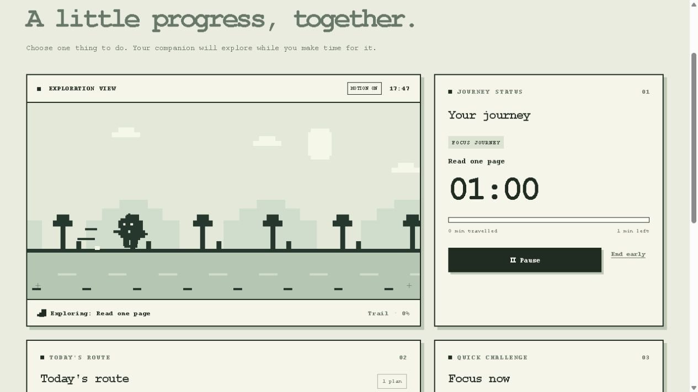

# Little Journey

Little Journey is a small pixel style focus companion for students and other people who want a gentle prompt to begin a task. Choose one thing to do, start a timed journey, and watch a tiny creature explore while you work. Completing a focus journey adds a discovery to the travel bag.



## Run it

Requires Node.js 18 or later. The server uses only built-in Node modules; there are no packages to install, accounts, API keys, or build steps.

From a fresh terminal in this repository:

```bash
node serve.mjs
```

Open <http://127.0.0.1:4173/> in a browser. Stop the server with `Ctrl+C`. The files in `dist/` can also be hosted on any static web server.

## Try the interaction

1. In **Focus now**, type a task such as “Read one page” and choose **TRY 1** for a one minute demonstration. Press **Prepare challenge**.
2. The selected task appears in the separate **Your journey** panel. Press **Start journey**. The pet runs, the scenery scrolls, and the countdown and progress bar update.
3. Pause and resume, or let the minute finish. The panel shows a journey report, and the travel bag gains a footprint. **End early** lets you stop without a reward.

You can also add an activity to **Today's route**, select it, and start it from the same journey panel. A scheduled time marks a route as ready; it does not start the timer by itself.

For an error check, leave the task field empty and press **Prepare challenge**. An inline message asks you to enter a task, and no journey starts. Invalid durations and overlapping planned activities also receive messages.

The top right switch changes between English and Chinese. English is the default in a new browser. **MOTION ON/OFF** above the scene lets you stop or restart the animation without pausing the timer. Plans, discoveries, language, and motion choice are stored in that browser's local storage.

## Files

- `dist/index.html`, `dist/style.css`, `dist/app.js` — the complete browser experience.
- `serve.mjs` — a small local static server.
- `assets/journey-running.png` — a screenshot of the running experience.
- `PROCESS.md` — design decisions, testing, trial notes, and AI use.
- `CREDITS.md` — source and inspiration credits.

## Known limitations

The timer measures elapsed time; it cannot tell whether the user is focused in another app. The page does not send system notifications. Plans last for the current day, and browser data does not sync between devices. Only completed focus journeys earn items; daily activities have a journey without a collectible reward. A public live demo is not currently available, so use the local run instructions above.

See [CREDITS.md](CREDITS.md) for media and tool credits.
